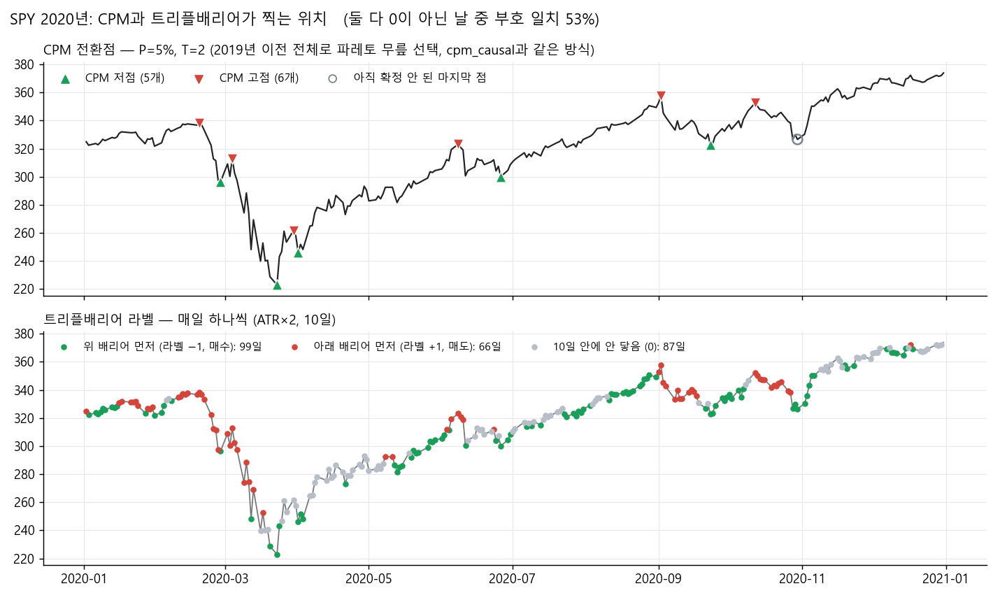

# 기술적 지표 + GA + ESN 주가 매매 신호 (캡스톤)

일봉 주가로 기술적 지표 20개(기간은 GA로 최적화)와 캔들 패턴 5개를 만들어 직접 구현한 Echo State Network(ESN)에 넣고, 매수 / 보유 / 매도 신호를 walk-forward로 만들어 단순 보유(buy & hold)와 비교한 1인 캡스톤 프로젝트입니다. 실험은 동결된 상태입니다.

```
가격(yfinance) → GA 파라미터(폴드별, 학습 구간만) → 입력(ta 지표 20 + 캔들 5)
  → [폴드마다: 라벨(cpm_causal) → 스케일링 → ESN 학습 → threshold → 테스트 연도 신호]
  → 테스트 연도를 이어 붙여 백테스트(다음 날 시가 체결, 비용 포함) → 보유와 비교(월 블록 부트스트랩)
```

## 방법 요약

| 단계 | 내용 |
|---|---|
| ESN | reservoir 100, spectral radius 0.9, sparsity 0.15, input scale 0.3, leak 0.3, washout 30, `[1, 입력, 상태]`에 대한 ridge readout(alpha 200). numpy로 직접 구현 ([esn.py](legacy_v1/model/esn.py)) |
| GA | 논문(Lin, Yang & Song 2011)의 매매 규칙 19개(지표 규칙 14 + 캔들 5)의 파라미터를, 폴드마다 학습 구간의 CPM 전환점에 대한 fitness로 탐색 ([ga/](legacy_v1/ga/)). 찾은 **기간**으로 지표 20개를 계산해 ESN 입력으로 씀 |
| 라벨 | `cpm_causal`: 폴드마다 학습 구간 가격만으로 CPM 전환점을 찾고, 전환점 사이를 −1~+1 삼각파로 이은 값 |
| Walk-forward | 학습 5년(rolling) / 검증 1년 / 테스트 1년, 1년씩 이동. 첫 테스트 연도는 2016-03부터 |
| 백테스트 | 전부 사거나 전부 팔기, 신호 다음 날 시가 체결, 수수료 0.05% + 슬리피지 0.05% |
| 평가 | Sharpe, 연수익률, MDD. 종목 간 비교는 Sharpe 차이 중앙값 + 월 블록 부트스트랩 95% 구간 ([judge.py](legacy_v1/experiments/judge.py)) |

**최종 설정 = `ga_ta_candle` (규칙 v1, `data/params`).** 나중에 추가한 규칙 v2(`ga2_ta_candle`, `data/params_v2`)는 비교 실험으로만 남겼습니다([부록](#부록-규칙-v2-ga2_ta_candle)). 단계별 세부 사항은 [방법 상세](#방법-상세)에 있습니다.

## 설치

Python 3.10 이상.

```bash
git clone https://github.com/oatmeal-kdk/capstone_final.git
cd capstone_final
python -m venv .venv
# Windows: .venv\Scripts\activate    macOS/Linux: source .venv/bin/activate
pip install -r requirements.txt          # 테스트까지 돌리려면: pip install -r requirements-dev.txt
```

라이브러리 버전은 프로젝트 진행 중에 고정하지 않았습니다. 최신 버전에서 수치가 조금 다르면 numpy·pandas·ta 버전부터 확인하세요.

모든 명령은 저장소 루트에서 `python -m ...`으로 실행합니다(스크립트가 `data/`, `results/`를 루트 기준 상대 경로로 읽음).

## 최종 결과 재현

**1. 가격 데이터 받기** (yfinance, 네트워크 필요)

```bash
python -m legacy_v1.data.fetch_prices --tickers SPY QQQ AAPL GLD
```

`data/processed/<종목>/1d/<종목>_with_tp.csv`가 생깁니다. 끝 날짜(`--end`)를 주지 않으면 `data/params/<종목>.json`에 저장된 마지막 테스트일(SPY 2026-05-29, QQQ·GLD 2026-08-11, AAPL 2026-09-23)에서 멈춥니다. 그래서 보고한 결과와 폴드도, 마지막 테스트 구간도 같습니다. 원래 결과를 계산한 가격 파일(capstone2에서 복사)은 저장소에 없고 Yahoo가 과거 데이터를 고칠 수 있어서, 수치가 소수점 단위로 다를 수 있습니다.

**2. GA 파라미터**: 저장소에 들어 있으므로 건너뜁니다.

`data/params/<종목>.json`(규칙 v1, 2026-11-08 저장)을 그대로 씁니다. 다시 만들려면 종목당 약 1시간 걸립니다.

```bash
python -m legacy_v1.pipeline.save_ga_params --tickers SPY QQQ AAPL GLD              # → data/params/ (v1)
python -m legacy_v1.pipeline.save_ga_params --tickers SPY QQQ AAPL GLD --rules v2   # → data/params_v2/ (부록 실험용)
```

**3. ESN 백테스트** (`results/legacy_v1/` 아래에 저장)

```bash
# 기본 ESN과 탐색 ESN, 시드 0 → results/legacy_v1/esn_backtest_ga_ta_candle_s0/
python -m legacy_v1.experiments.select_esn_backtest --tickers SPY QQQ AAPL GLD --inputs ga_ta_candle --seeds 0 --tag s0
# 기본 ESN, 시드 0~9 앙상블 → results/legacy_v1/esn_backtest_ga_ta_candle_ens10/
python -m legacy_v1.experiments.select_esn_backtest --tickers SPY QQQ AAPL GLD --inputs ga_ta_candle --default-only --seeds 0 1 2 3 4 5 6 7 8 9 --tag ens10
```

결과는 각 폴더에 있습니다: `compare.csv`(종목별 Sharpe), `verdicts.csv`(보유 대비 판정), `daily_*.csv`(일별 수익률), `folds.csv`(폴드별 선택 결과와 Spearman 상관).

**4. 결과 표 만들기** (저장된 일별 수익률만 읽고, 다시 학습하지 않음)

```bash
python -m legacy_v1.experiments.report_tables combos   # → results/legacy_v1/tables_combos.md
```

`combos`는 입력 4종(`ta`, `ta_candle`, `ga_ta_candle`, `ga2_ta_candle`) × ESN 3종을 모두 읽습니다. 그래서 3단계 명령을 `--inputs ta`, `--inputs ta_candle`, `--inputs ga2_ta_candle`로도 실행해야 합니다(태그는 그대로). 보유 수익률은 `esn_backtest_s0/daily_hold.csv`(`--inputs ta --tag s0` 실행 결과)에서 읽습니다.

한 종목만 빠르게 보려면 단일 실행 스크립트를 씁니다. CLI 기본 비용이 0이라 비용은 직접 지정합니다.

```bash
python -m legacy_v1.pipeline.run_walkforward --tp-path data/processed/SPY/1d/SPY_with_tp.csv --fee-rate 0.0005 --slippage-rate 0.0005 --output-dir results/legacy_v1/walkforward_SPY
```

**테스트**

```bash
python -m pytest
```

[tests/](tests/)는 결과 수치가 아니라 성질만 확인합니다. 지표가 미래 행을 보지 않는지, 트리플배리어 라벨이 10일보다 앞을 보지 않는지, `cpm_causal`이 마지막(미확정) 전환점 이후를 버리는지, 신호가 다음 날 시가에 체결되는지를 봅니다.

## 핵심 결과

테스트 구간은 2016-03부터 각 종목 데이터 끝까지, 4종목(SPY, QQQ, AAPL, GLD), 다음 날 시가 체결, 비용 포함입니다. 숫자는 `report_tables combos`의 "4종목 평균" 표에서 옮깁니다.

| 입력 | ESN 기본값 | ESN 탐색 | ESN 앙상블 10 |
|---|---|---|---|
| ta (기본 기간) | 0.695 / 11.5% / −28.0% | 0.644 / 11.3% / −27.2% | 0.704 / 10.8% / −25.7% |
| ta + 캔들 | 0.735 / 12.6% / −28.0% | 0.681 / 11.9% / −26.9% | 0.730 / 11.6% / −25.7% |
| **ta_ga + 캔들 (최종)** | **0.760 / 13.1% / −28.9%** | 0.572 / 9.4% / −28.9% | 0.761 / 12.9% / −27.0% |
| ta_ga v2 + 캔들 (부록) | 0.730 / 12.3% / −27.0% | 0.705 / 12.0% / −26.3% | 0.720 / 12.3% / −27.0% |
| 보유 | 0.890 / 18.6% / −33.7% (ESN 무관) | | |

셀 = 4종목 평균 Sharpe / 연수익률 / MDD.

- 최종 설정(ta_ga + 캔들, ESN 기본값)은 네 입력 중 Sharpe가 가장 높지만(0.760), **보유(0.890)보다 Sharpe와 연수익률이 낮습니다.** 대신 MDD는 보유보다 작습니다(−28.9% vs −33.7%).
- GA 기간(ta_ga)과 캔들 입력은 기본 기간 ta보다 Sharpe를 조금 올렸습니다(0.695 → 0.735 → 0.760, ESN 기본값 기준).
- ESN 탐색은 모든 입력에서 기본값보다 Sharpe가 낮고, ta_ga + 캔들에서 가장 크게 떨어졌습니다(0.760 → 0.572). 앙상블 10은 기본값과 Sharpe가 거의 같고, MDD는 v2를 빼면 약간 줄였습니다.
- 규칙 v2는 v1보다 Sharpe가 낮았습니다(0.730 vs 0.760). 통계적 판정(월 블록 부트스트랩 구간)은 `tables_combos.md`의 "규칙 v2 vs v1" 표에 있습니다.

## 한계

- **보유를 이기지 못했습니다.** 4종목 평균 Sharpe 0.760 vs 0.890, 연수익률 13.1% vs 18.6%로 보유가 높습니다. 보유보다 나은 점은 낙폭이 작다는 것(MDD −28.9% vs −33.7%)뿐입니다.
- **ESN 하이퍼파라미터 탐색이 다음 해로 이어지지 않습니다.** 폴드마다 후보 243개의 "선택 연도 Sharpe"와 "다음 테스트 연도 Sharpe"의 순위 상관(Spearman)이 세 입력 모두 약 0입니다. 과거 성과로 고른 설정이 다음 해에도 낫다는 근거가 없어서, 최종 설정은 탐색 없이 고정된 `ESN_CONFIG`를 씁니다.
- **종목 수가 적습니다.** 최종 비교는 4종목입니다. 라벨·threshold·readout 비교만 64종목(SPY, QQQ, AAPL, GLD + 미국·한국 무작위 각 30)으로 했습니다.
- **시드에 민감합니다.** reservoir의 무작위 연결에 따라 신호가 달라집니다. 앙상블 10은 흔들림을 줄일 뿐, 기대 성능을 올린다는 보장은 없습니다.
- **비용·체결 모델이 단순합니다.** 고정 비율 비용, 전량 매수·매도, 세금 없음, 시가 체결을 가정합니다.
- **데이터 재현성.** 원래 가격 파일은 저장소에 없어서 yfinance로 다시 받습니다. 라이브러리 버전도 고정하지 않았습니다.
- **발표 자료와 범위가 다릅니다.** 2026-11-23 발표에서 쓴 이후 실험(규칙 v2 신호 17개 입력, threshold 0.7 고정, ESN 후보 405개, S&P 100·OEF 포트폴리오)의 코드는 이 저장소에 들어 있지 않습니다. 이 저장소는 2026-11-16 시점의 코드와 그 결과를 정리한 것입니다.
- **미구현 옵션.** [cpm.py](legacy_v1/labels/cpm.py)의 일부 옵션은 `NotImplementedError`를 냅니다(기본 경로에서는 쓰지 않음).

## 저장소 구조

| 경로 | 내용 |
|---|---|
| [legacy_v1/pipeline/](legacy_v1/pipeline/) | 단일 종목 walk-forward(`run_walkforward`), GA 파라미터 저장(`save_ga_params`), 유니버스 스크리닝(`screen_universe`), 공통 설정(`production_config`) |
| [legacy_v1/experiments/](legacy_v1/experiments/) | 비교 실험과 표·그림 스크립트 ([실험 목록](#실험-목록)) |
| [ga/](legacy_v1/ga/), [model/](legacy_v1/model/), [labels/](legacy_v1/labels/), [features/](legacy_v1/features/), [backtest/](legacy_v1/backtest/) (모두 `legacy_v1/` 아래) | GA·ESN·라벨·지표·백테스트 구현 |
| [legacy_v1/data/](legacy_v1/data/) | 가격 받기(`fetch_prices`)와 전처리 |
| `data/params/`, `data/params_v2/` | 저장된 GA 파라미터 (v1, v2) |
| `data/universe/` | 스크리닝 결과 (`*_screening_results.csv`) |
| `data/processed/`, `results/` | 받은 가격과 실험 결과 (git 추적 안 함) |
| [tests/](tests/) | 최소 회귀 테스트 |

**패키지 이름이 `legacy_v1`인 이유**: 이전 저장소(capstone2)의 Phase 12 v1 파이프라인을 떼어 와서 이 저장소를 시작했기 때문입니다. 이름을 바꾸면 모든 import 경로, `python -m` 명령, 결과 파일에 남은 경로를 함께 바꿔야 해서 실험 동결 상태에서는 그대로 두었습니다.

## 방법 상세

### 1. 데이터

`data/processed/<종목>/1d/<종목>_with_tp.csv`(일봉, `--tp-path`)를 씁니다. [fetch_prices.py](legacy_v1/data/fetch_prices.py)가 만듭니다.

| 파일 | 내용 |
|---|---|
| `<종목>_clean.csv` | Date, Open, High, Low, Close, Volume (수정주가 아님, `auto_adjust=False`) |
| `<종목>_with_tp.csv` | 위 + `turning_label`, `cpm_point_type` (전체 기간 CPM 전환점. 미래 정보가 섞인 참고용 라벨 `cpm`과 일부 그림에서만 읽음) |

64종목 실험(`--per-market 30`)은 `compare_labels.py`가 고르는 종목을 쓰므로, 그 종목들의 가격도 같은 방법으로 받아야 합니다(`fetch_prices --tickers ...`).

### 2. 입력

| `--inputs` | 입력 | 열 수 | 쓰는 곳 |
|---|---|---|---|
| **`ga_ta_candle`** (최종) | 규칙 v1의 GA 기간으로 계산한 ta 지표 20개(학습 구간 min/max 스케일링) + GA 파라미터의 캔들 패턴 5개(−1/0/+1) | 25 | `run_walkforward` 기본값, `select_esn_backtest` |
| `ta` | ta 지표 20개, 기본 기간 | 20 | 비교 실험 |
| `ta_candle` | ta 20개(기본 기간) + 캔들 5개(기본 파라미터) | 25 | `select_esn_backtest` |
| `ga` | 규칙 19개의 −1/0/+1 신호(논문 방식) | 19 | `select_esn_backtest` |
| `ga2_ta_candle` | 규칙 v2 지표 23개 + 캔들 시스템 신호 1개 | 24 | [부록](#부록-규칙-v2-ga2_ta_candle) |

**지표 20개** ([ta_features.py](legacy_v1/features/ta_features.py)의 `TA_FEATURE_COLUMNS`. GA 기간 적용은 [features.py](legacy_v1/ga/features.py)의 `ta_values_from_params`). 임계값은 쓰지 않고 GA가 찾은 기간만 씁니다.

| 분류 | 열 | 기간을 가져오는 규칙 |
|---|---|---|
| 모멘텀 (7) | `ta_rsi` / `ta_stoch_k`, `ta_stoch_d` / `ta_stochrsi_k` / `ta_williams_r` / `ta_roc` / `ta_ultimate_osc` | rsi / stoch / stochrsi / williams_r / roc / ultimate |
| 추세 (6) | `ta_adx`, `ta_adx_pos`, `ta_adx_neg` / `ta_cci` / `ta_trix` / `ta_aroon_osc` | adx / cci / trix / aroon |
| 변동성 (4) | `ta_bb_pband`, `ta_bb_wband` / `ta_keltner_pband` / `ta_atr_pct` | bollinger / keltner / 고정 14 |
| 거래량 (3) | `ta_mfi` / `ta_cmf` / `ta_pvo` | mfi / cmf / 고정 12·26, 신호선 9 |

**규칙 v1 19개** ([rules.py](legacy_v1/ga/rules.py)): 지표 규칙 14개(rsi, stoch, stochrsi, williams_r, roc, ultimate, adx, cci, trix, aroon, bollinger, keltner, mfi, cmf)와 논문 2.6절의 캔들 패턴 5개(해머/행잉맨, 먹구름, 관통형, 상승·하락 장악형). 지표 규칙은 대부분 `band_cross` 방식입니다. 과매도 구간에서 다시 올라오는 날 매수, 과매수 구간에서 다시 내려오는 날 매도. 각 규칙은 −1(매수) / 0 / +1(매도) 신호를 냅니다.

**fitness** ([fitness.py](legacy_v1/ga/fitness.py))

| 항목 | 내용 |
|---|---|
| 구역 | 전환점 Tᵢ의 구역 = 앞 전환점과의 중간 ~ 뒤 전환점과의 중간. 신호 하나는 한 전환점에만 속함. 앞뒤 전환점이 모두 있는 Tᵢ만 평가 |
| 맞는 신호 | 바닥 구역의 매수, 꼭대기 구역의 매도. 그중 가격이 가장 가까운 것 하나로 \|close(S) − close(Tᵢ)\| |
| 놓침 | 맞는 신호가 없으면 진폭 Aᵢ (바닥: 앞뒤 전환점 사이 최고가 − 바닥가, 꼭대기: 꼭대기가 − 최저가) |
| 틀린 신호 | 바닥 구역의 매도: 2 × (사이 최고가 − 신호 가격), 꼭대기 구역의 매수: 2 × (신호 가격 − 사이 최저가). 구역마다 가장 큰 벌점 하나만 더함 |
| 전환점 점수 | (맞는 신호 오차 또는 Aᵢ) + 틀린 신호 벌점, 전환점 가격으로 나눈 비율 |
| 합계 | 모든 전환점 점수의 합 ÷ 신호가 하나도 없을 때의 점수(Σ Aᵢ / 가격) |

**GA** ([optimizer.py](legacy_v1/ga/optimizer.py))

| 항목 | 설정 |
|---|---|
| 개체 | 규칙 하나의 파라미터 묶음. 초기 개체 중 하나는 기본값이라, 학습 구간에서는 기본값보다 나빠지지 않음 |
| 개체 수 / 세대 | 30 / 20 (`--population`, `--generations`) |
| 선택 | 토너먼트 3 |
| 교차 | 확률 0.7, 유전자마다 1/2 확률로 BLX-0.5 섞기 |
| 변이 | 유전자마다 확률 0.2, 정규분포 (σ = 범위 × 0.1) |
| 보정 | 범위로 자르기, 기간은 정수로 반올림, Ultimate는 짧은 순서 유지 |
| 엘리트 | 상위 2개는 그대로 다음 세대로 |

**저장된 파라미터** (`data/params/<종목>.json`: `python -m legacy_v1.pipeline.save_ga_params`. v2는 `data/params_v2/`: `--rules v2`)

| 키 | 내용 | 용도 |
|---|---|---|
| `folds` | 폴드마다(테스트 시작일 기준) 학습 구간, P·T, 규칙별 파라미터와 학습·기본값 fitness | 백테스트. 폴드 k의 테스트에는 폴드 k의 값만 쓰므로 미래 정보 없음 |
| `live` | 마지막 폴드(가장 최근 학습 5년)의 값 | 앞으로의 매매. 과거 연도 백테스트에는 쓰지 않음 |

### 3. 라벨

| 선택지 | 내용 | 미래 정보 |
|---|---|---|
| triple_barrier | 종가 ± k×ATR(14) 배리어 중 max_holding일 안에 먼저 닿는 쪽: 위 −1(매수), 아래 +1(매도), 둘 다 아니면 0. **k = 2.0, 10일** (`--tb-atr-mult`, `--tb-max-holding`) | 없음. 학습·검증 끝 10일은 라벨을 버림 |
| **cpm_causal** | 폴드마다 학습 구간 가격만으로 CPM의 P·T를 파레토 무릎으로 고르고, 전환점 사이를 −1~+1 삼각파로 이은 연속값. 확정되지 않은 마지막 전환점 이후는 버림 | 없음 |
| cpm | 가격 파일의 `cpm_point_type` 열 (전체 기간으로 만든 전환점) | **있음.** `--allow-lookahead` 없이는 실행 거부 |
| cpm_global | P·T를 전체 기간으로 고른 CPM | **있음.** 위와 같음 |

두 라벨이 SPY 2020년에 찍히는 위치


`python -m legacy_v1.experiments.plot_labels --ticker SPY --years 2020 --no-targets --out-dir docs/figures`로 다시 그릴 수 있습니다. `--no-targets`를 빼면 ESN 목표값 패널이 붙은 그림이 `results/legacy_v1/figures/`에 저장됩니다.

### 4. 학습

**학습 단위**

| 선택지 | 내용 | 위치 |
|---|---|---|
| **단일 종목** | 한 종목의 시계열 전체를 ESN에 끊김 없이 넣음. 종목마다 모델 하나 | [run_walkforward.py](legacy_v1/pipeline/run_walkforward.py) |
| 여러 종목 | 종목별 "직전 20일" window를 0 상태에서 읽어 행으로 쌓음. 학습 행은 5일 간격. 시장(US/KOSPI/KOSDAQ)마다 모델 하나 | [pooled.py](legacy_v1/experiments/pooled.py) |

**Training window**

| 선택지 | 내용 | 지정 방법 |
|---|---|---|
| **Rolling window** | 검증 직전 `--train-years`년(5년)만. 폴드마다 window 전체가 1년씩 뒤로 이동 | `--train-window rolling` (기본값) |
| Expanding window | 데이터 시작부터 검증 직전까지. 시작점은 고정되고 window 끝만 1년씩 뒤로 감 (첫 폴드 5년). v1 원래 값 | `--train-window expanding` |

**모델**

| 항목 | 선택지 |
|---|---|
| 스케일링 | **학습 행의 min/max로 [−1, 1]** ([scaling.py](legacy_v1/model/scaling.py)) |
| reservoir | **100개, spectral radius 0.9, sparsity 0.15, input scale 0.3, leak 0.3, washout 30** ([run_walkforward.py](legacy_v1/pipeline/run_walkforward.py)의 `ESN_CONFIG`) |
| readout | **ridge 회귀, alpha 200** (`[1, 입력, 상태]` → 점수) / 로지스틱 분류 ([pooled_classifier.py](legacy_v1/experiments/pooled_classifier.py)에서만) |
| 앙상블 | **1개** (실험) / 10개 (서비스 설정, [production_config.py](legacy_v1/pipeline/production_config.py)). `--ensemble-size`, `--random-state` |

**시드 앙상블** (`--ensemble-size N`)

시드는 reservoir의 무작위 연결(W_in, W)을 정합니다. 설정이 같아도 시드가 다르면 신호가 달라집니다.

```
시드 42, 43, …, 42+N−1의 ESN N개 → 같은 입력·라벨로 readout을 각각 학습 → 날마다 점수를 평균
→ 평균 점수로 threshold 선택과 신호 생성 → 신호 하나로 백테스트 한 번
```

Sharpe를 평균하는 것이 아니라 점수를 평균합니다. 시드 운에 따른 흔들림은 줄지만 기대 성능이 오른다는 보장은 없습니다.

**ESN 파라미터 탐색** ([select_esn_backtest.py](legacy_v1/experiments/select_esn_backtest.py), 실험 전용)

| 항목 | 내용 |
|---|---|
| 후보 | 243개: reservoir 50 / 100 / 200, spectral radius 0.5 / 0.9 / 1.1, input scale 0.1 / 0.3 / 0.7, leak 0.1 / 0.3 / 0.7, ridge alpha 20 / 200 / 2000 (sparsity 0.15 고정, 기본값 포함) |
| 선택 기준 | 폴드마다 학습 3·4·5년차와 검증 연도의 백테스트 Sharpe가 가장 높은 후보. 테스트 연도는 보지 않음 |
| 공통 조건 | 시드 0, 1 앙상블, threshold = 학습 \|점수\| 상위 20%, 다음 날 시가 체결, 비용 0.05% + 0.05% |
| 입력 | `--inputs ta / ta_candle / ga_ta_candle / ga2_ta_candle`. 최종 설정은 `ga_ta_candle` (`data/params`의 저장된 GA 값) |
| 비교 | 고른 후보 vs 기본값 vs 보유, [judge.py](legacy_v1/experiments/judge.py)의 월 블록 부트스트랩 |

선택 기준 Sharpe와 다음 해 Sharpe가 거의 무관해서(ta·ta_candle·ga_ta_candle 세 입력 모두 Spearman 약 0), 기본 파이프라인은 ESN 탐색 없이 `ESN_CONFIG`를 그대로 씁니다.

### 5. threshold와 신호

| 선택지 | 내용 | 위치 |
|---|---|---|
| **검증 정확도 최대** | {0.1, …, 0.9} 중 선택. 점수 < −thr 매수, > thr 매도, 그 사이 보유 | [thresholds.py](legacy_v1/model/thresholds.py) |
| 학습 점수 상위 20% | 학습 기간의 약 20%에서 신호가 켜지도록 고정 | [pooled_classifier.py](legacy_v1/experiments/pooled_classifier.py) |

### 6. 백테스트

모든 폴드의 테스트 구간 신호를 이어 붙여 한 번에 실행합니다 ([simple_backtest.py](legacy_v1/backtest/simple_backtest.py)).

| 항목 | 선택지 | 지정 방법 |
|---|---|---|
| 체결 | **다음 날 시가** (기본값) / 신호 당일 종가 (v1 원래 값. 신호를 만든 종가에 바로 체결하므로 실제로는 불가능. v1 숫자를 재현할 때만 사용) | `--execution next_open / same_close` |
| 비중 | **전부 사거나 전부 팔기** / 리스크 오버레이: 비중 = min(1, 목표 변동성 ÷ 20일 변동성), 차이가 밴드를 넘을 때만 조정. **목표 10%, 밴드 10%p** | `--risk-overlay`, `--target-vol`, `--rebalance-band` |
| 비용 | **수수료 0.05%, 슬리피지 0.05%** (CLI 기본값은 0이라 직접 지정) | `--fee-rate`, `--slippage-rate` |

### 7. 평가

| 선택지 | 내용 | 위치 |
|---|---|---|
| 단일 종목 요약 | Sharpe, 연수익, 최대 낙폭, 같은 기간 보유 성과 | 출력 폴더의 `summary.json` |
| 스크리닝 | Sharpe ≥ 0.40 active, 0.20~0.40 weak, 그 아래 excluded | [screen_universe.py](legacy_v1/pipeline/screen_universe.py) |
| 여러 종목 비교 | 종목별 Sharpe 차이의 중앙값 + 월 단위 블록 부트스트랩 95% 구간 → 이김 / 짐 / 구분 안 됨 | [judge.py](legacy_v1/experiments/judge.py) |

## 실험 목록

모든 실험은 `python -m legacy_v1.experiments.<이름>`으로 실행하고 `results/legacy_v1/` 아래에 저장합니다. 각 파일 맨 위 docstring에 실행 전에 정한 설계(비교 대상, 고정 조건, 판정 방법)가 적혀 있습니다.

**실험별로 바꾼 단계** ("v1" = 이 저장소를 시작할 때 가져온 원래 v1 파이프라인 설정. `ta` 입력 등, 이후 기본값이 바뀌기 전 값)

| 실험 | 바꾼 단계 | 나머지 |
|---|---|---|
| [compare_execution.py](legacy_v1/experiments/compare_execution.py) | 6. 체결 | v1 |
| [compare_labels.py](legacy_v1/experiments/compare_labels.py) | 3. 라벨 (triple_barrier / cpm_causal) | v1, 다음 날 시가 체결, 64종목 |
| [compare_train_window.py](legacy_v1/experiments/compare_train_window.py) | 4. Training window (expanding / rolling) | v1, 다음 날 시가 체결 |
| [compare_readout.py](legacy_v1/experiments/compare_readout.py) | 4. readout (`[1, 입력, 상태]` / `[1, 상태]`) | ta 20, 트리플배리어, 검증 정확도 threshold, 64종목 |
| [compare_thresholds.py](legacy_v1/experiments/compare_thresholds.py) | 5. threshold (검증 정확도 / 학습 점수 상위 20% / 0) | ta 20, 트리플배리어 또는 cpm_causal(`--label`), 64종목 |
| [compare_sizing.py](legacy_v1/experiments/compare_sizing.py) | 6. 비중 (전량 / 분할 2·4 / 이틀 확인 / 점수 비례) + 점수 크기의 정보량 진단 | 끝난 `run_walkforward` 실행의 점수를 다시 매매 (재학습 없음) |
| [select_esn_backtest.py](legacy_v1/experiments/select_esn_backtest.py) | 4. ESN 파라미터 탐색(243개) vs 기본값, 2. 입력(`--inputs`) | cpm_causal, 학습 점수 상위 20% threshold, 4종목 |
| [compare_reservoir.py](legacy_v1/experiments/compare_reservoir.py) | 4. reservoir 크기(500 / 1000 / 3000) × spectral radius(0.1 ~ 0.9) | `select_esn_backtest`의 `ga_ta_candle` 설계, 선택 없이 모든 설정을 매매 |
| [pooled.py](legacy_v1/experiments/pooled.py) | 4. 학습 단위, 3. 라벨 | ridge, 검증 정확도 |
| [pooled_classifier.py](legacy_v1/experiments/pooled_classifier.py) | 4. readout, 5. threshold와 신호 해석 | pooled 설정 |
| [ga_indicator_params.py](legacy_v1/experiments/ga_indicator_params.py) | 2. 입력의 GA (규칙별 fitness 확인) | 학습 구간 CPM 전환점 |

**표·그림 (저장된 결과만 읽음)**

| 스크립트 | 만드는 것 |
|---|---|
| [report_tables.py](legacy_v1/experiments/report_tables.py) | `combos`: 입력 4종 × ESN 3종의 Sharpe·연수익률·MDD 표(전체·폴드별), 규칙 v2 vs v1 판정, 규칙별 GA fitness. `reservoir`: `compare_reservoir` 결과 표 |
| [plot_mdd_matrix.py](legacy_v1/experiments/plot_mdd_matrix.py) | 입력 3종 × ESN 3종(9개 전략)의 MDD 차이 9×9 행렬 |
| [plot_labels.py](legacy_v1/experiments/plot_labels.py), [plot_cpm_truth.py](legacy_v1/experiments/plot_cpm_truth.py), [mark_cpm.py](legacy_v1/experiments/mark_cpm.py), [label_profile.py](legacy_v1/experiments/label_profile.py) | 라벨·CPM 전환점 그림과 통계 |
| [plot_signals.py](legacy_v1/experiments/plot_signals.py) | 가격 위의 매수·매도 신호 그림 |
| [judge.py](legacy_v1/experiments/judge.py) | 판정 함수(다른 실험이 import) |

## 부록: 규칙 v2 (`ga2_ta_candle`)

2026-11-16에 추가한 비교 실험입니다. 논문(Lin, Yang & Song 2011, 2절) 규칙을 더 충실히 옮기고 지표를 23개로 늘렸습니다. 최종 설정에는 쓰지 않습니다.

- 실행: `python -m legacy_v1.pipeline.save_ga_params --rules v2`로 `data/params_v2/`를 만든 뒤 `select_esn_backtest --inputs ga2_ta_candle` (기본 `--ga-params data/params_v2`).
- v1과의 비교는 `report_tables combos`의 "규칙 v2 vs v1" 표에 나옵니다.

### 지표 23개 ([features.py](legacy_v1/ga/features.py)의 `TA_V2_COLUMNS`)

임계값은 쓰지 않고, 각 규칙에서 GA가 찾은 기간만 씁니다.

| 분류 | 열 | 기간을 가져오는 규칙 |
|---|---|---|
| 모멘텀 (8) | `ta_rsi` | rsi |
| | `ta_stoch_k`, `ta_stoch_d` | stoch |
| | `ta_stochrsi_k` | stochrsi |
| | `ta_williams_r` | williams_r |
| | `ta_roc_short`, `ta_roc_long` | roc (짧은·긴 ROC) |
| | `ta_ultimate_osc` | ultimate |
| 추세 (8) | `ta_adx`, `ta_adx_pos`, `ta_adx_neg` | adx |
| | `ta_cci` | cci |
| | `ta_trix` | trix |
| | `ta_aroon_osc` | aroon |
| | `ta_ma_gap` | ma_cross: (MA(long) − MA(short)) ÷ MA(long) × 100 |
| | `ta_ma_dev` | ma_envelope: (종가 ÷ MA − 1) × 100 |
| 변동성 (4) | `ta_bb_pband`, `ta_bb_wband` | bollinger |
| | `ta_atr_pct`, `ta_keltner_pband` | squeeze (ATR 기반 켈트너 채널) |
| 거래량 (3) | `ta_mfi` | mfi |
| | `ta_cmf` | cmf |
| | `ta_pvo` | 고정 12·26, 신호선 9 |

### 규칙 v2 17개 ([rules_v2.py](legacy_v1/ga/rules_v2.py))

각 규칙은 가격을 −1(매수) / 0 / +1(매도) 신호로 바꾸고, GA가 전환점 fitness로 파라미터를 고릅니다. 상태에서 나오는 신호(roc, aroon, mfi, ma_cross)는 상태가 시작된 첫날에만 냅니다.

**논문 규칙 (Lin, Yang & Song 2011, 2절)**

| 규칙 | 매수 / 매도 조건 | 파라미터 |
|---|---|---|
| ma_cross | z = (MA(long) − MA(short)) ÷ MA(long) × 100. z > 0 구간의 최대 간격 M이 b × c를 넘은 뒤 z < min(M ÷ a, c)로 좁혀지면 매수(골든크로스 직전). 매도는 −z에 a′, b′, c′로 대칭 | short, long, a, b, c, sa, sb, sc |
| ma_envelope | MA(window) ± p1 % / p2 % 밴드. MA가 하락 중일 때 종가가 위 밴드를 상향 돌파하면 매수, MA가 상승 중일 때 아래 밴드를 하향 돌파하면 매도 | window, p1, p2 |
| rsi | RSI가 upper를 넘은 날부터 하루 기울기 p의 사선을 긋고, RSI가 그 아래로 내려오면 매도. lower 아래로 내려간 날부터 기울기 −q의 사선, RSI가 그 위로 올라오면 매수 | window, lower, upper, p, q |
| roc | 긴 ROC > upper이고 짧은 ROC가 균형선 근처(−band_down ~ band_up)면 매도, 긴 ROC < lower이고 짧은 ROC가 근처면 매수 | short, long, upper, lower, band_up, band_down |
| stoch | %K가 %D를 상향 돌파하고 %K < a, %K − %D < b면 매수. 하향 돌파하고 %K > c, %D − %K < d면 매도 | window, smooth, a, b, c, d |
| candle | 해머/행잉맨, 먹구름, 관통형, 장악형을 한 시스템으로. 하락 추세 뒤 상승 패턴이면 매수, 상승 추세 뒤 하락 패턴이면 매도. 추세 = 전날 종가와 MA(trend) 비교 | a, b, c, d, e, f, g, trend |

**캔들 패턴** (candle 규칙 안)

| 패턴 | 조건 | 방향 |
|---|---|---|
| 해머 / 행잉맨 | 아래 꼬리 ≥ a × 몸통, 아래 꼬리 > 위 꼬리. 하락 추세 뒤면 해머, 상승 추세 뒤면 행잉맨 | 추세로 결정 |
| 관통형 | 음봉 다음 양봉, 시가 ≤ 전날 종가, 종가 < 전날 시가, \|전날 시가 − 종가\| < c × 전날 몸통 | 상승 |
| 먹구름 | 양봉 다음 음봉, 시가 ≥ 전날 종가, 종가 > 전날 시가, \|종가 − 전날 시가\| < b × 전날 몸통 | 하락 |
| 상승 장악형 | 음봉 다음 양봉, 시가 ≤ 전날 종가 − d × 전날 몸통, 종가 ≥ 전날 시가 + e × 전날 몸통 | 상승 |
| 하락 장악형 | 양봉 다음 음봉, 시가 ≥ 전날 종가 + f × 전날 몸통, 종가 ≤ 전날 시가 − g × 전날 몸통 | 하락 |

**두 조건 규칙 (논문에 없는 지표)**

| 규칙 | 매수 / 매도 조건 | 파라미터 |
|---|---|---|
| trix | TRIX가 신호선(TRIX의 EMA)을 상향 돌파하고 TRIX ≤ lower면 매수, 하향 돌파하고 ≥ upper면 매도 | window, signal, lower, upper |
| aroon | Aroon Up이 Down을 상향 돌파하고 전날 Down ≥ strong이면 매수(바닥 직후). 매도는 대칭 | window, strong |
| bollinger | %B가 lower/upper를 다시 넘을 때 신호, 밴드 폭 ≥ w_min일 때만 | window, dev, lower, upper, w_min |
| squeeze | 볼린저 밴드가 켈트너 채널 안에 min_days일 이상 있다가 빠져나올 때 종가가 중심선 위면 매수, 아래면 매도 | window, dev, atr_window, mult, min_days |
| mfi | 종가가 lookback일 신저가인데 MFI는 자기 저점보다 gap 이상 높고 그 저점이 lower 이하면 매수(다이버전스). 매도는 대칭 | window, lookback, lower, upper, gap |
| cmf | CMF가 buy_level을 상향 돌파하면 매수, sell_level을 하향 돌파하면 매도. PVO ≥ pvo_min(거래량 증가)일 때만 | window, buy_level, sell_level, pvo_min |

**한 지표 규칙**: adx, williams_r, cci, stochrsi, ultimate (수준 돌파형, [rules.py](legacy_v1/ga/rules.py)와 같음)

