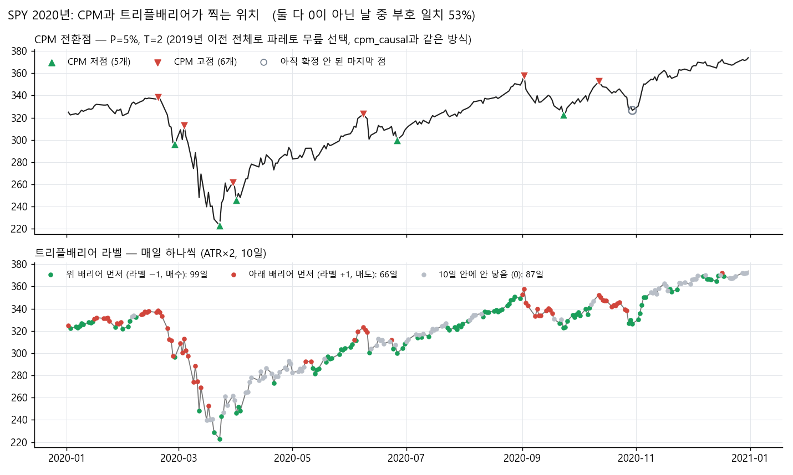

# capstone

파이프라인 흐름:

```
데이터 → GA 파라미터(폴드별) → 입력(ta 지표 + 캔들) → [폴드마다: 라벨 → 스케일링 → ESN 학습 → threshold 선택 → 테스트 신호] → 백테스트 → 평가
```


## 1. 데이터

저장된 가격 파일 `data/processed/<종목>/1d/<종목>_with_tp.csv`(일봉)를 씁니다. `--tp-path`로 지정합니다.

| 폴더 | 내용 |
|---|---|
| `data/raw/` | 종목 목록(`sp500/sp400/kospi/kosdaq_constituents.csv`, `krx_delisted.csv`)과 일부 종목의 원본 가격 |
| `data/processed/` | 종목별 일봉. `_clean.csv`(OHLCV), `_with_tp.csv`(OHLCV + CPM 열, 파이프라인 입력) |
| `data/labels/` | 종목별 CPM 전환점 (`data/labels/cpm/`) |
| `data/universe/` | 스크리닝 결과 (`*_screening_results.csv`) |

## 2. 입력


| `--inputs` | 입력 | 열 수 |
|---|---|---|
| **`ga_ta_candle`** (기본) | GA 파라미터로 계산한 ta 20개 + GA 파라미터 캔들 5개 | 25 |
| `ga` | GA 규칙 신호 19개 (ta 규칙 14개 + 캔들 5개, 논문 입력) | 19 |
| `ta_candle` | ta 20개 + 캔들 5개, 모두 기본 파라미터 | 25 |
| `ta` | ta 20개, 기본 파라미터 (v1 원래 입력) | 20 |


### ta 지표 20개

**모멘텀 (7)**  

| 열 | 지표 | 기간 | 범위 | 의미 |
|---|---|---|---|---|
| `ta_rsi` | RSI | 14 | 0~100 | 최근 상승폭과 하락폭의 비율 |
| `ta_stoch_k` | 스토캐스틱 %K | 14 | 0~100 | 최근 14일 고저 범위 안에서 종가의 위치 |
| `ta_stoch_d` | 스토캐스틱 %D | 14, 평활 3 | 0~100 | %K의 3일 단순평균 |
| `ta_stochrsi_k` | 스토캐스틱 RSI %K | 14, 평활 3 | 0~1 | RSI에 스토캐스틱을 적용한 값의 3일 단순평균 |
| `ta_williams_r` | Williams %R | 14 | −100~0 | %K − 100 (%K와 같은 정보) |
| `ta_roc` | 변화율 | 12 | % | 12일 전 대비 종가 변화율 |
| `ta_ultimate_osc` | Ultimate Oscillator | 7·14·28 | 0~100 | 세 기간 매수 압력의 가중 평균 |

**추세 (6)**

| 열 | 지표 | 기간 | 범위 | 의미 |
|---|---|---|---|---|
| `ta_adx` | ADX | 14 | 0~100 | 추세의 강도 (방향 없음) |
| `ta_adx_pos` | +DI | 14 | 0~100 | 상승 방향 움직임의 강도 |
| `ta_adx_neg` | −DI | 14 | 0~100 | 하락 방향 움직임의 강도 |
| `ta_cci` | CCI | 20 | 상한 없음 | 평균 가격에서 벗어난 정도 |
| `ta_trix` | TRIX | 15 | % | 3중 지수이동평균의 변화율 |
| `ta_aroon_osc` | Aroon 오실레이터 | 25 | −100~100 | Aroon Up − Aroon Down |

**변동성 (4)**

| 열 | 지표 | 기간 | 범위 | 의미 |
|---|---|---|---|---|
| `ta_bb_pband` | 볼린저 %B | 20, 2σ | 보통 0~1 | 볼린저 밴드 안에서 종가의 위치 |
| `ta_bb_wband` | 볼린저 밴드 폭 | 20, 2σ | % | 밴드 폭 ÷ 중심선 |
| `ta_atr_pct` | ATR ÷ 종가 | 14 | % | 하루 평균 변동폭의 가격 대비 비율 |
| `ta_keltner_pband` | 켈트너 %B | 20, ATR 10 | 보통 0~1 | 켈트너 채널 안에서 종가의 위치 |

**거래량 (3)**

| 열 | 지표 | 기간 | 범위 | 의미 |
|---|---|---|---|---|
| `ta_mfi` | MFI | 14 | 0~100 | 거래량을 반영한 RSI |
| `ta_cmf` | Chaikin Money Flow | 20 | −1~1 | 종가가 하루 범위 위쪽에서 마감한 날의 거래량 비중 |
| `ta_pvo` | PVO | 12·26, 신호선 9 | % | 거래량 단기·장기 지수이동평균의 차이 비율 |

### 캔들 패턴 5개


| 패턴 | 파라미터 (범위, 기본값) | 조건 | 신호 |
|---|---|---|---|
| 해머 / 행잉맨 | a (1~5, 2) | 아래 꼬리 ≥ a × 몸통, 아래 꼬리 > 위 꼬리 | 양봉 −1, 음봉 +1 |
| 먹구름 | b (0~1, 0.5) | 양봉 다음 음봉, 시가 ≥ 전날 종가, 종가 ≤ 전날 종가 − b × 전날 몸통, 종가 > 전날 시가 | +1 |
| 관통형 | c (0~1, 0.5) | 음봉 다음 양봉, 시가 ≤ 전날 종가, 종가 ≥ 전날 종가 + c × 전날 몸통, 종가 < 전날 시가 | −1 |
| 상승 장악형 | d, e (0~0.5, 0) | 음봉 다음 양봉, 시가 ≤ 전날 종가 − d × 전날 몸통, 종가 ≥ 전날 시가 + e × 전날 몸통 | −1 |
| 하락 장악형 | f, g (0~0.5, 0) | 양봉 다음 음봉, 시가 ≥ 전날 종가 + f × 전날 몸통, 종가 ≤ 전날 시가 − g × 전날 몸통 | +1 |


**지표 규칙 14개** ([rules.py](legacy_v1/ga/rules.py))

**fitness** ([fitness.py](legacy_v1/ga/fitness.py))

| 항목 | 내용 |
|---|---|
| 구역 | 전환점 Tᵢ의 구역 = 앞 전환점과의 중간 ~ 뒤 전환점과의 중간. 신호 하나는 한 전환점에만 속함. 앞뒤 전환점이 모두 있는 Tᵢ만 평가 |
| 맞는 신호 | 바닥 구역의 매수, 꼭대기 구역의 매도. 그중 가격이 가장 가까운 것 하나로 \|close(S) − close(Tᵢ)\| |
| 놓침 | 맞는 신호가 없으면 진폭 Aᵢ (바닥: 앞뒤 전환점 사이 최고가 − 바닥가, 꼭대기: 꼭대기가 − 최저가) |
| 틀린 신호 | 바닥 구역의 매도: 2 × (사이 최고가 − 신호 가격), 꼭대기 구역의 매수: 2 × (신호 가격 − 사이 최저가). 구역마다 가장 큰 벌점 하나만 더함 |
| 전환점 점수 | (맞는 신호 오차 또는 Aᵢ) + 틀린 신호 벌점, 전환점 가격으로 나눈 비율 |
| 합계 | 모든 전환점 점수의 합 ÷ 신호가 하나도 없을 때의 점수(Σ Aᵢ / 가격) |


**GA** ([optimizer.py](legacy_v1/ga/optimizer.py))

| 항목 | 설정 |
|---|---|
| 개체 | 규칙 하나의 파라미터 묶음. 초기 개체 중 하나는 기본값이라, 학습 구간에서는 기본값보다 나빠지지 않음 |
| 개체 수 / 세대 | 30 / 20 (`--population`, `--generations`) |
| 선택 | 토너먼트 3 |
| 교차 | 확률 0.7, 유전자마다 1/2 확률로 BLX-0.5 섞기 |
| 변이 | 유전자마다 확률 0.2, 정규분포 (σ = 범위 × 0.1) |
| 보정 | 범위로 자르기, 기간은 정수로 반올림, Ultimate는 짧은 순서 유지 |
| 엘리트 | 상위 2개는 그대로 다음 세대로 |

**저장된 파라미터** (`data/params/<종목>.json`, [save_ga_params.py](legacy_v1/pipeline/save_ga_params.py))

| 키 | 내용 | 용도 |
|---|---|---|
| `folds` | 폴드마다(테스트 시작일 기준) 학습 구간, P·T, 규칙 19개의 파라미터와 학습·기본값 fitness | 기본 파이프라인과 백테스트. 폴드 k의 테스트에는 폴드 k의 값만 쓰므로 미래 정보 없음 (`run_walkforward.py` 기본 입력, `select_esn_backtest.py --inputs ga --ga-params data/params`) |
| `live` | 마지막 폴드(가장 최근 학습 5년)의 값 | 앞으로의 매매. 과거 연도 백테스트에는 쓰지 않음 |


## 3. 라벨


| 선택지 | 내용 | 미래 정보 |
|---|---|---|
| triple_barrier | 종가 ± k×ATR(14) 배리어 중 max_holding일 안에 먼저 닿는 쪽: 위 −1(매수), 아래 +1(매도), 둘 다 아니면 0. **k = 2.0, 10일** (`--tb-atr-mult`, `--tb-max-holding`) | 없음. 학습·검증 끝 10일은 라벨을 버림 |
| **cpm_causal** | 폴드마다 학습 구간 가격만으로 CPM의 P·T를 파레토 무릎으로 고르고, 전환점 사이를 −1~+1 삼각파로 이은 연속값. 확정되지 않은 마지막 전환점 이후는 버림 | 없음 |
| cpm | 가격 파일의 `cpm_point_type` 열 (전체 기간으로 만든 전환점) | **있음.** `--allow-lookahead` 없이는 실행 거부 |
| cpm_global | P·T를 전체 기간으로 고른 CPM | **있음.** 위와 같음 |


두 라벨이 SPY 2020년에 찍히는 위치


`python -m legacy_v1.experiments.plot_labels --ticker SPY --years 2020 --no-targets --out-dir docs/figures`로 다시 그릴 수 있습니다. `--no-targets`를 빼면 ESN 목표값 패널이 붙은 그림이 `results/legacy_v1/figures/`에 저장됩니다.

## 4. 학습

**학습 단위**

| 선택지 | 내용 | 위치 |
|---|---|---|
| **단일 종목** | 한 종목의 시계열 전체를 ESN에 끊김 없이 넣음. 종목마다 모델 하나 | [run_walkforward.py](legacy_v1/pipeline/run_walkforward.py) |
| 여러 종목 | 종목별 "직전 20일" window를 0 상태에서 읽어 행으로 쌓음. 학습 행은 5일 간격. 시장(US/KOSPI/KOSDAQ)마다 모델 하나 | [pooled.py](legacy_v1/experiments/pooled.py) |

**Training window**

| 선택지 | 내용 | 지정 방법 |
|---|---|---|
| **Rolling window** | 검증 직전 `--train-years`년(5년)만. 폴드마다 window 전체가 1년씩 뒤로 이동 | `--train-window rolling` (기본값) |
| Expanding window | 데이터 시작부터 검증 직전까지. 시작점은 고정되고 window 끝만 1년씩 뒤로 감 (첫 폴드 5년). v1 원래 값 | `--train-window expanding` |


**모델**

| 항목 | 선택지 |
|---|---|
| 스케일링 | **학습 행의 min/max로 [−1, 1]** ([scaling.py](legacy_v1/model/scaling.py)) |
| reservoir | **100개, spectral radius 0.9, sparsity 0.15, input scale 0.3, leak 0.3, washout 30** ([run_walkforward.py](legacy_v1/pipeline/run_walkforward.py)의 `ESN_CONFIG`) |
| readout | **ridge 회귀, alpha 200** (`[1, 입력, 상태]` → 점수) / 로지스틱 분류 ([pooled_classifier.py](legacy_v1/experiments/pooled_classifier.py)에서만) |
| 앙상블 | **1개** (실험) / 10개 (서비스 설정, [production_config.py](legacy_v1/pipeline/production_config.py)). `--ensemble-size`, `--random-state` |

**시드 앙상블** (`--ensemble-size N`)

시드는 reservoir의 무작위 연결(W_in, W)을 정합니다. 설정이 같아도 시드가 다르면 신호가 달라집니다.

```
시드 42, 43, …, 42+N−1의 ESN N개 → 같은 입력·라벨로 readout을 각각 학습 → 날마다 점수를 평균
→ 평균 점수로 threshold 선택과 신호 생성 → 신호 하나로 백테스트 한 번
```

Sharpe를 평균하는 것이 아니라 점수를 평균합니다. 시드 운에 따른 흔들림은 줄지만 기대 성능이 오른다는 보장은 없습니다.

**ESN 파라미터 탐색** ([select_esn_backtest.py](legacy_v1/experiments/select_esn_backtest.py), 실험 전용)

| 항목 | 내용 |
|---|---|
| 후보 | 243개: reservoir 50 / 100 / 200, spectral radius 0.5 / 0.9 / 1.1, input scale 0.1 / 0.3 / 0.7, leak 0.1 / 0.3 / 0.7, ridge alpha 20 / 200 / 2000 (sparsity 0.15 고정, 기본값 포함) |
| 선택 기준 | 폴드마다 학습 3·4·5년차와 검증 연도의 백테스트 Sharpe가 가장 높은 후보. 테스트 연도는 보지 않음 |
| 공통 조건 | 시드 0, 1 앙상블, threshold = 학습 \|점수\| 상위 20%, 다음 날 시가 체결, 비용 0.05% + 0.05% |
| 입력 | `--inputs ta` / `ga` / `ga_ta_candle` (`--ga-params data/params`로 저장된 GA 값 사용) |
| 비교 | 고른 후보 vs 기본값 vs 보유, [judge.py](legacy_v1/experiments/judge.py)의 월 블록 부트스트랩 |

선택 기준 Sharpe와 다음 해 Sharpe가 거의 무관해서(입력 세 가지 모두 Spearman 약 0), 기본 파이프라인은 ESN 탐색 없이 `ESN_CONFIG`를 그대로 씁니다.

## 5. threshold와 신호

| 선택지 | 내용 | 위치 |
|---|---|---|
| **검증 정확도 최대** | {0.1, …, 0.9} 중 선택. 점수 < −thr 매수, > thr 매도, 그 사이 보유 | [thresholds.py](legacy_v1/model/thresholds.py) |
| 학습 점수 상위 20% | 학습 기간의 약 20%에서 신호가 켜지도록 고정 | [pooled_classifier.py](legacy_v1/experiments/pooled_classifier.py) |


## 6. 백테스트

모든 폴드의 테스트 구간 신호를 이어 붙여 한 번에 실행합니다 ([simple_backtest.py](legacy_v1/backtest/simple_backtest.py)).

| 항목 | 선택지 | 지정 방법 |
|---|---|---|
| 체결 | **다음 날 시가** (기본값) / 신호 당일 종가 (v1 원래 값. 신호를 만든 종가에 바로 체결하므로 실제로는 불가능. v1 숫자를 재현할 때만 사용) | `--execution next_open / same_close` |
| 비중 | **전부 사거나 전부 팔기** / 리스크 오버레이: 비중 = min(1, 목표 변동성 ÷ 20일 변동성), 차이가 밴드를 넘을 때만 조정. **목표 10%, 밴드 10%p** | `--risk-overlay`, `--target-vol`, `--rebalance-band` |
| 비용 | **수수료 0.05%, 슬리피지 0.05%** (CLI 기본값은 0이라 직접 지정) | `--fee-rate`, `--slippage-rate` |

## 7. 평가

| 선택지 | 내용 | 위치 |
|---|---|---|
| 단일 종목 요약 | Sharpe, 연수익, 최대 낙폭, 같은 기간 보유 성과 | 출력 폴더의 `summary.json` |
| 스크리닝 | Sharpe ≥ 0.40 active, 0.20~0.40 weak, 그 아래 excluded | [screen_universe.py](legacy_v1/pipeline/screen_universe.py) |
| 여러 종목 비교 | 종목별 Sharpe 차이의 중앙값 + 월 단위 블록 부트스트랩 95% 구간 → 이김 / 짐 / 구분 안 됨 | [judge.py](legacy_v1/experiments/judge.py) |

## 실험별로 바꾼 단계

| 실험 | 바꾼 단계 | 나머지 |
|---|---|---|
| [compare_execution.py](legacy_v1/experiments/compare_execution.py) | 6. 체결 | v1 |
| [compare_labels.py](legacy_v1/experiments/compare_labels.py) | 3. 라벨 (triple_barrier / cpm_causal) | v1, 다음 날 시가 체결 |
| [compare_train_window.py](legacy_v1/experiments/compare_train_window.py) | 4. Training window (expanding / rolling) | v1, 다음 날 시가 체결 |
| [pooled.py](legacy_v1/experiments/pooled.py) | 4. 학습 단위, 3. 라벨 | ridge, 검증 정확도 |
| [pooled_classifier.py](legacy_v1/experiments/pooled_classifier.py) | 4. readout, 5. threshold와 신호 해석 | pooled 설정 |
